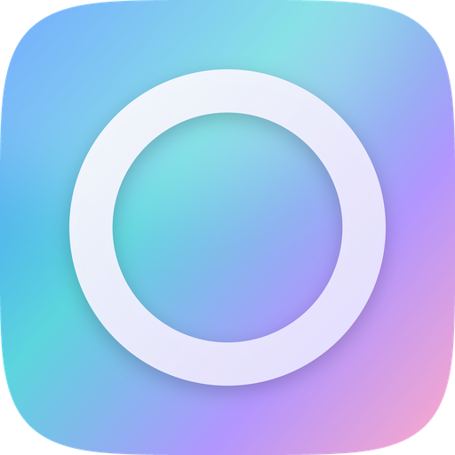
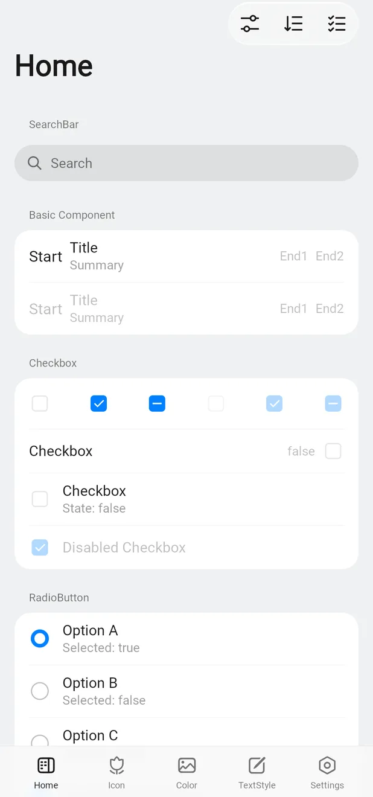
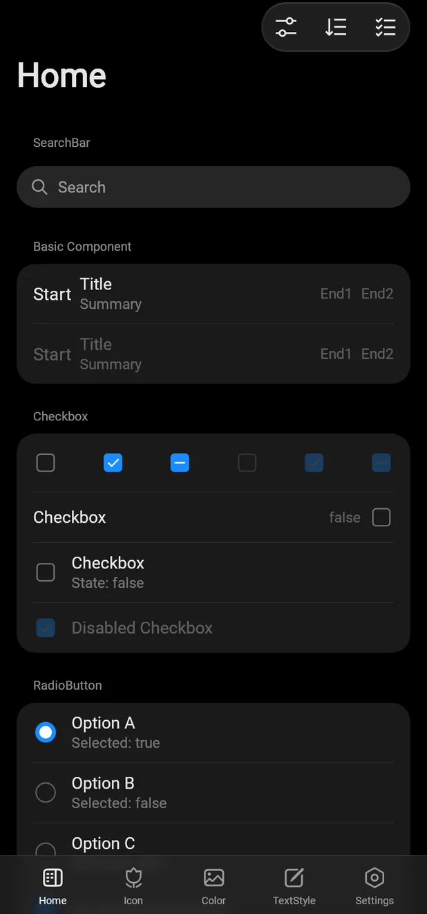
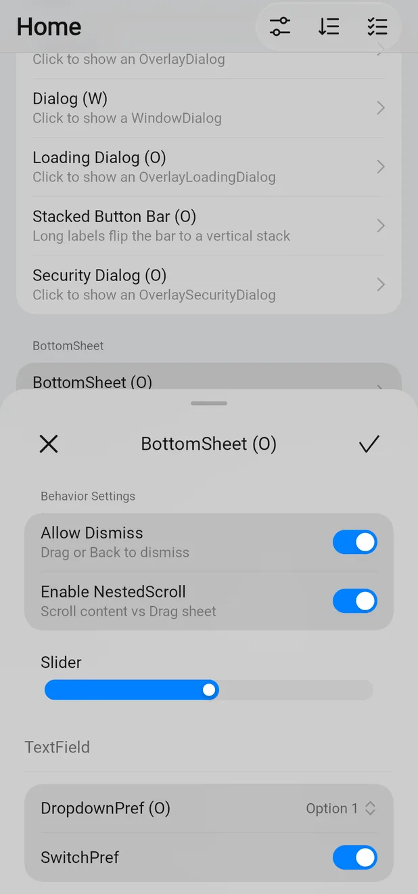
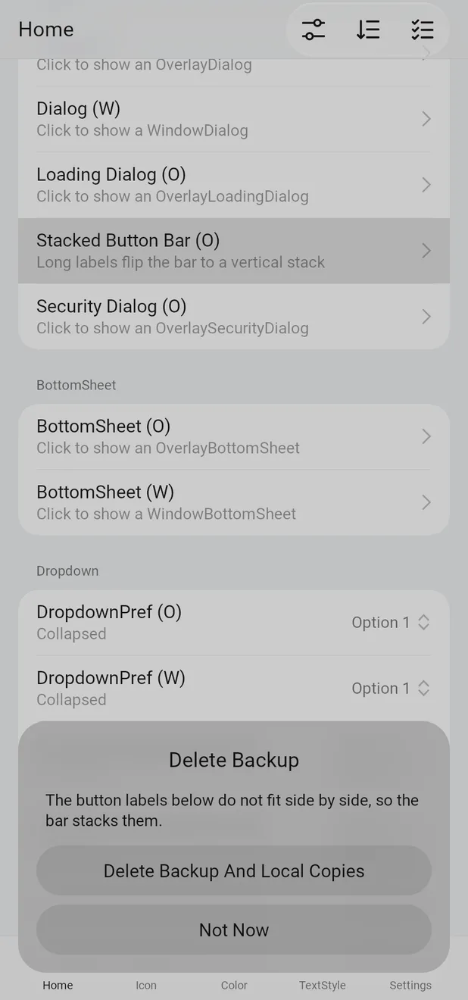

<p align="center">
  
</p>

<h1 align="center">Opaline</h1>

<p align="center">
  A Compose Multiplatform UI library in the <b>ColorOS 17</b> design language.
</p>

<p align="center">
  <a href="https://kotlinlang.org/"></a>
  <a href="https://kotlinlang.org/compose-multiplatform/"></a>
  <a href="LICENSE"></a>
  
  
  
  
  
</p>

Colors, metrics, corner radii, typography, motion and the new ColorOS 17 glass material are read
from the real system software rather than eyeballed. Every value cites the system resource it came
from, and [docs/coui17-delta.md](docs/coui17-delta.md) lists what changed from ColorOS 16, where
each value came from, and what is still unverified.

> Opaline is experimental (0.x). APIs may change between releases.

<p align="center">
  
  
  
  
</p>

## Documentation and demo

- Docs: <https://a1b2d56.github.io/opaline/>
- Live demo (WasmJs): <https://a1b2d56.github.io/opaline/example/>

## Modules

| Module                     | Description                                                            |
| -------------------------- | ---------------------------------------------------------------------- |
| `opaline-ui`               | Components and theming (brings in `opaline-core` and `opaline-squircle`) |
| `opaline-preference`       | Preference, menu and popup components                                  |
| `opaline-icons`            | ColorOS 17 icon set                                                    |
| `opaline-blur`             | Backdrop blur and the ColorOS 17 glass material                        |
| `opaline-nav`              | Self-contained navigation runtime with gesture back                    |
| `opaline-navigation3-ui`   | Navigation 3 UI                                                        |
| `opaline-shader`           | Runtime shader abstraction used by blur                                |
| `opaline-squircle`         | Smooth (squircle) corner shapes                                        |

## Getting started

```kotlin
kotlin {
    sourceSets {
        commonMain.dependencies {
            implementation("io.github.a1b2d56.opaline:opaline-ui:0.1.0")
            // Optional modules
            implementation("io.github.a1b2d56.opaline:opaline-preference:0.1.0")
            implementation("io.github.a1b2d56.opaline:opaline-icons:0.1.0")
            implementation("io.github.a1b2d56.opaline:opaline-blur:0.1.0")
            implementation("io.github.a1b2d56.opaline:opaline-navigation3-ui:0.1.0")
        }
    }
}
```

Artifacts are not on Maven Central yet; until the first release, build from source.

## Usage

Wrap your UI in `OpalineTheme`:

```kotlin
@Composable
fun AppTheme(content: @Composable () -> Unit) {
    val colors = if (isSystemInDarkTheme()) darkColorScheme() else lightColorScheme()
    OpalineTheme(colors = colors, content = content)
}
```

Use `ThemeController` for system/light/dark modes and Monet dynamic colors (`keyColor` sets the seed):

```kotlin
@Composable
fun AppTheme(content: @Composable () -> Unit) {
    val controller = remember {
        ThemeController(ColorSchemeMode.MonetSystem, keyColor = Color(0xFF0080FF))
    }
    OpalineTheme(controller = controller, content = content)
}
```

### ColorOS 17 material

ColorOS 17 gives bars, search, dialogs and sheets a glass material: a backdrop blur, two blended
color layers and a light rim. With `opaline-blur`, record the page once and the components draw it:

```kotlin
val backdrop = rememberLayerBackdrop()
ProvideMaterialBackdrop(backdrop) {
    Scaffold(
        topBar = { TopAppBar(title = "Settings") },     // glass controls
        bottomBar = { NavigationBar { /* items */ } },  // glass bar
    ) { padding ->
        MaterialBackdropSource(backdrop) { /* page content */ }
    }
}
```

Where runtime shaders are unavailable the components keep their solid fills. See the
[material guide](https://a1b2d56.github.io/opaline/guide/material).

## Building

```bash
./gradlew compileKotlinDesktop          # quick check
./gradlew check                         # tests, formatting, license headers, API dumps
./gradlew :example:desktop:hotRunDesktop --auto
```

[CONTRIBUTING.md](CONTRIBUTING.md) has the conventions and the full command list. Changes to the public API need
`./gradlew updateKotlinAbi`.

## Credits

Opaline stands on two Apache-2.0 projects, and their copyright notices are kept in the files they
wrote:

- **[Miuix](https://github.com/compose-miuix-ui/miuix)** by YuKongA and the compose-miuix-ui
  contributors. It supplied the component library, theming system, blur, shader, squircle,
  navigation and icon modules, the example app and the docs site.
- **[COUI](https://github.com/suqi8/coui)** by suqi8 and contributors. This fork of Miuix rethemed it
  to ColorOS 16 and added several components (Chip, CodeTextField, date and time pickers, InputView,
  Stepper, TopTips, FullPageStatement, loading and security dialogs, and more).

Parts of `opaline-navigation3-ui` come from AndroidX Navigation 3 (The Android Open Source Project).
See [NOTICE](NOTICE) for details and the list of changes.

## License

Apache License 2.0, see [LICENSE](LICENSE) and [NOTICE](NOTICE).

ColorOS, COUI, OPPO and OnePlus are trademarks of their respective owners. Opaline is an independent
project and is not affiliated with or endorsed by them.
